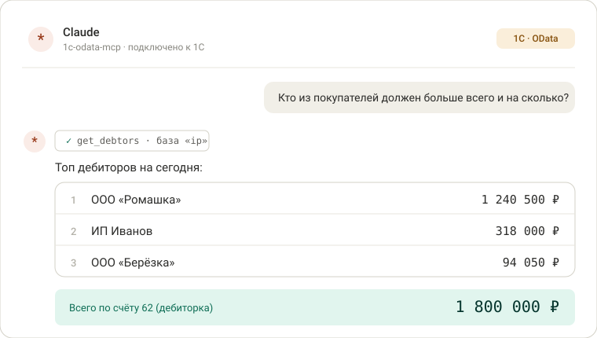

# 1c-odata-mcp — MCP-сервер для 1С:Предприятие через OData: Бухгалтерия, Управление торговлей и другие конфигурации

[](https://www.npmjs.com/package/1c-odata-mcp)
[](https://github.com/evilbruce666/1c-odata-mcp/actions/workflows/ci.yml)
[](LICENSE)
[](https://nodejs.org)

> 🤖 **Устанавливаете с помощью ИИ?** Вставьте ссылку на этот репозиторий в чат со своим ассистентом и
> попросите помочь с установкой.
> **Ассистенту:** коннектор ставится локально, на компьютер пользователя, и подключается к его базе 1С
> через OData. Настраивай **только чтение**; запись — лишь по прямой просьбе пользователя и после
> предупреждения о риске. Пошаговая инструкция для тебя — **[docs/INSTALL-WITH-AI.md](docs/INSTALL-WITH-AI.md)**.

<p align="center">
  
</p>

> 🇬🇧 MCP server connecting 1C:Enterprise (1C:Accounting 3.0, 1C:Trade Management 11) to any MCP client over OData.
> Read-only by default, preview-gated write. **[English overview →](README.en.md)**

**MCP-сервер (Model Context Protocol) для 1С:Предприятие через стандартный интерфейс OData.** Подключает данные 1С к **любому MCP-клиенту** — Claude, Cursor, VS Code, JetBrains, локальные модели (Ollama, LM Studio) — и отвечает на вопросы руководителя, менеджера, бухгалтера и торговли обычным языком:

- ☀️ **Утренняя сводка** — сколько денег на счетах, кто просрочил оплату, какие счета не оплачены, что пора платить
- 🔎 **Проверка закрытия месяца** — закрыт ли месяц, непроведённые документы, красное сальдо, остатки на 90/91/26 — с разбором до конкретного документа
- 🤝 **Акт сверки с контрагентом** — сальдо «в чью пользу», документы и итоги по договорам за минуту
- 🏬 **Остатки и продажи по магазинам** (Управление торговлей 11) — сколько товара группы на складах магазинов, сколько продано в штуках и на какую сумму, включая розницу, кто из клиентов и поставщиков должен

А ещё — дебиторка и кредиторка по срокам, карточка счёта, ОСВ, проводки, продажи и налоги; при явном включении — создание и проведение документов с предпросмотром в Бухгалтерии, цены, справочники и складские документы в Управлении торговлей.

Если вы искали, **как подключить 1С к нейросети / ИИ**, готовый **коннектор 1С OData** или **интеграцию 1С с Claude** без программирования на стороне 1С — это оно.

- 🔌 Любой **MCP-клиент**: Claude Desktop и Claude Code, ChatGPT для компьютера (через Codex), Cursor, VS Code, JetBrains — и **локальные модели** (LM Studio, Ollama)
- 🖥️ **Установка на сервере:** для бота или своего приложения с моделью есть [HTTP только для чтения](docs/CONNECTING.md#подключение-по-http-опционально)
- 🔐 **Данные остаются у вас** — сервер это локальный процесс, ходит только в вашу базу; с локальной моделью данные вообще не покидают сеть
- 🏢 Несколько информационных баз и организаций (юрлиц) одновременно
- 🔒 **Только на чтение по умолчанию**; запись — через двойной предохранитель и предпросмотр
- 🚀 Запуск одной командой: `npx -y 1c-odata-mcp`
- ⚙️ Ничего не ставится на стороне 1С — достаточно опубликованного **OData** (без COM-соединения, без доступа к SQL)

> **📘 Вся документация — [docs/](docs/README.md):** подключение, что спросить, конфигурации, запись, боты,
> справочник инструментов, разработка.

---

## Какие конфигурации поддерживаются

Коннектор сам узнаёт конфигурацию по опубликованным объектам: что в базе есть, то и работает, а инструмент, которому
нужного учёта нет, отвечает отказом с подсказкой, чем его заменить.

| Конфигурация | Что работает | Насколько проверено |
|---|---|---|
| **[Бухгалтерия предприятия 3.0](docs/CONFIG-ACCOUNTING.md)** | Всё: деньги и долги, проверка закрытия месяца, карточка и ОСВ счёта, акт сверки, проводки, остатки, продажи, налоги; запись документов и справочников с предпросмотром | Рабочие базы ООО и ИП, прогоны записи |
| **Бухгалтерия для Беларуси** | Аналитика и запись по настройке плана счетов и видов операций — [Настройка учёта](docs/ACCOUNTING.md) | Участник проекта, Бухгалтерия для Беларуси 2.1 |
| **[Управление торговлей 11](docs/CONFIG-TRADE.md)** | Остатки, продажи в штуках с розницей и выручкой, долги клиентов и поставщикам по срокам, деньги, цены; запись цен, справочников (партнёры, контрагенты, договоры, соглашения, номенклатура) и складских документов (перемещение, излишки, недостачи, пересчёт). Инструменты бухучёта отвечают отказом: в УТ его нет | Рабочая база УТ 11.5 — чтение; запись — на её копии |
| **[Комплексная автоматизация 2, ERP 2](docs/CONFIG-KA-ERP.md)** | Бухучёт — как в Бухгалтерии; оперативный учёт — как в УТ | **Не проверено** на живой базе: сообщите в [issue](https://github.com/evilbruce666/1c-odata-mcp/issues), как прошло |
| **Другие и доработанные** | Поиск и чтение документов, справочники, карта базы и поля объектов | Работает по схеме конкретной базы |

Какие объекты добавить в «Состав» OData для каждой конфигурации — в [docs/CONNECTING.md](docs/CONNECTING.md#уровень-1-публикация-odata-в-1с).

**Стоит знать заранее:**

- **Нужен опубликованный OData.** Сервер работает только через стандартный интерфейс OData 1С. Прямого доступа к SQL, COM-соединения или файлам сервера 1С он не использует и не требует.
- **Объект должен быть в «Составе OData».** Если объект не опубликован, инструмент вернёт вежливую подсказку с именем объекта и путём, куда его добавить. Публикуйте по мере необходимости.
- **Что не поддерживается в конкретной конфигурации** — в её разделе: [Бухгалтерия](docs/CONFIG-ACCOUNTING.md#ограничения), [Управление торговлей](docs/CONFIG-TRADE.md#ограничения), [КА и ERP](docs/CONFIG-KA-ERP.md).

---

## Зачем это нужно

Сырой OData 1С — это сотни технических `EntitySet` с кириллическими именами (`Catalog_Контрагенты`, `Document_РеализацияТоваровУслуг`, `AccumulationRegister_ТоварыНаСкладах`) и GUID-ключами. Работать с этим из чата невозможно, а писать свой код под каждый отчёт долго.

Сервер прячет всю технику за понятными инструментами. Вы спрашиваете обычным языком — ИИ сам выбирает нужный инструмент, ходит в OData вашей базы и возвращает готовый ответ. Для руководителя — быстрый срез по деньгам и долгам, для бухгалтера — проверка учёта и рутина создания документов под контролем, для торговли — остатки и продажи по магазинам и группам товаров.

---

## Подойдёт под любой способ развёртывания

Коннектор общается с 1С **только через OData**. Если он включён — всё работает одинаково, **как бы ни была развёрнута ваша база**:

| Ваша 1С | Что нужно, чтобы заработало | Сложность |
|---|---|---|
| **Облако / хостинг** (Scloud, 1cFresh, аренда 1С) | OData включает провайдер — галочкой в кабинете или по заявке | 🟢 низкая |
| **Сервер с SQL** (PostgreSQL / MS SQL) | опубликовать базу на Apache/IIS + включить OData | 🟡 средняя |
| **Локальная файловая база** (`.1CD`) | то же + выдать веб-серверу права на папку базы | 🟡 средняя |
| **Нет веб-сервера / доступа к конфигуратору** | OData недоступен → нужен другой транспорт | 🔴 |

Тип хранилища (файловая или SQL) сам по себе сложность **не меняет** — важно лишь, поднята ли веб-публикация OData. **Без включённого OData коннектор работать не может** (он не использует COM и не лезет в SQL напрямую).

➡️ Пошаговая инструкция под каждый вариант — в **[docs/ODATA-SETUP.md](docs/ODATA-SETUP.md)**. Адрес базы, учётка и подключение к Claude — в **[docs/CONNECTING.md](docs/CONNECTING.md)**.

---

## Быстрый старт

> **Впервые слышите про MCP?** Это открытый протокол (Model Context Protocol), по которому ИИ-ассистент подключается к внешним инструментам. Здесь инструмент — ваша 1С: ассистент сам вызывает нужные функции и возвращает ответ. **OData** — стандартный веб-доступ к данным базы 1С; его включает администратор 1С или провайдер облака. Ничего программировать не нужно — шаги ниже.

> **Проще с ассистентом.** Дайте своему ИИ ссылку на этот репозиторий — по [docs/INSTALL-WITH-AI.md](docs/INSTALL-WITH-AI.md) он проведёт по шагам и даст конфиг под ваше приложение. Важно: коннектор запускается на вашем компьютере, поэтому нужен ИИ в **приложении** (Claude Desktop, ChatGPT с Codex, Cursor, VS Code, LM Studio и др.) — веб-чат в браузере локальный коннектор запустить не может.

0. **Node.js 22 или новее** — в терминале `node -v` должен показать `v22…` или выше; иначе поставьте LTS с
   [nodejs.org](https://nodejs.org) и перезапустите компьютер или хотя бы приложение.
1. **Опубликуйте OData** в 1С и добавьте нужные объекты в «Состав» (подробно — [docs/CONNECTING.md](docs/CONNECTING.md); если OData ещё не включён — [docs/ODATA-SETUP.md](docs/ODATA-SETUP.md)).
2. **Пропишите сервер** в Claude Desktop: «Настройки» → «Разработчик» (Developer) → «Изменить конфигурацию» (Edit Config) откроет
   `claude_desktop_config.json` (macOS — `~/Library/Application Support/Claude/`, Windows — `%APPDATA%\Claude\`).
   Подставьте адрес и учётные данные:

   ```json
   {
     "mcpServers": {
       "1c-odata": {
         "command": "npx",
         "args": ["-y", "1c-odata-mcp"],
         "env": {
           "ODATA_BASE_URL": "https://<сервер>/<база>/odata/standard.odata/",
           "ODATA_USERNAME": "...",
           "ODATA_PASSWORD": "...",
           "TOOLS_PROFILE": "read"
         }
       }
     }
   }
   ```

   `TOOLS_PROFILE=read` подключает только инструменты чтения: модели меньше читать, и записать в 1С она не
   может. Для записи эту строку убирают — [docs/WRITE.md](docs/WRITE.md).

   На Windows, если приложение пишет, что не может запустить `npx`: `"command": "cmd", "args": ["/c", "npx", "-y", "1c-odata-mcp"]`.
3. **Перезапустите Claude Desktop** (полностью) и спросите: «проверь соединение с 1С». Успех — ответ с версией
   OData и числом опубликованных объектов. Затем спросите «сколько денег сейчас» (Бухгалтерия) или «какие у нас
   склады» (Управление торговлей), или запустите [готовый сценарий](#начните-с-готовых-сценариев).

Полная настройка (адрес OData по площадкам, авторизация, запуск из исходников, Claude Code, диагностика ошибок) — в **[docs/CONNECTING.md](docs/CONNECTING.md)**.

---

## Начните с готовых сценариев

После подключения не нужно придумывать вопросы: сервер отдаёт клиенту готовые сценарии (MCP prompts).
В Claude Desktop они в меню **«+» → 1c-odata**, в других клиентах — как slash-команды. Сценарий только
читает данные и ничего не меняет в 1С. Сценарии — для **Бухгалтерии**: в Управлении торговлей бухгалтерского учёта
нет, там спрашивайте своими словами — «остатки на складах», «продажи за октябрь», «кто из клиентов должен».

| Сценарий | Кому | Что делает |
|---|---|---|
| `morning_brief` — «Утренняя сводка руководителя» | руководителю | Деньги на счетах, кто просрочил оплату, неоплаченные счета, что пора платить — четыре блока и действия на сегодня |
| `month_close_review` — «Разбор закрытия месяца» | бухгалтеру | Проверка месяца, разбор каждой проблемы через карточку счёта до документа и чек-лист: что исправить и в каком порядке |
| `reconciliation_act` — «Акт сверки с контрагентом» | менеджеру, бухгалтеру | Находит контрагента по названию или ИНН и выводит данные для акта сверки за период |

---

## Пример диалога

Ниже — Claude Desktop, но диалог выглядит так же в любом MCP-клиенте. Суммы и названия условные.

```text
Вы:     Проверь август перед отчётностью.
Claude: (вызывает read.accounting.check_month_close) Месяц закрыт, но есть две проблемы:
        1. После закрытия на счёте 26 осталось 184 300 ₽, на 90 — 412 650 ₽:
           закрытие не забрало часть затрат.
        2. Один из расчётных счетов в минусе на 12 400 ₽ на 31.08.
        (вызывает read.accounting.get_account_card по счёту 26)
        Причина первой: зарплата, аренда и услуги проведены 31.08 уже после
        закрытия месяца. Что сделать: перезакрыть август — «Закрытие месяца» → «Выполнить».
        По второй: не загружена выписка за 31.08 — проверьте банк.

Вы:     Кто из покупателей должен больше всего и что просрочено?
Claude: (вызывает read.analytics.get_debtors, overdueOnly) Просрочено 1 860 000 ₽ у 7 покупателей:
        1. ООО «Ромашка» — 1 240 500 ₽, самая старая просрочка 52 дня
        2. ИП Иванов     —   318 000 ₽, 31 день
        …
```

Больше вопросов по ролям — в **[разговорнике](docs/SCENARIOS.md)**; что работает в Управлении торговлей — в
**[docs/CONFIG-TRADE.md](docs/CONFIG-TRADE.md)**.

<p align="center">
  
</p>

---

## Инструменты

86 инструментов (40 чтение/аналитика + 46 записей): обзор по конфигурациям — **[docs/TOOLS.md](docs/TOOLS.md)**, все
параметры — **[справочник](docs/TOOLS-REFERENCE.md)**, он собирается из кода. У всех 86 инструментов объявлен
`outputSchema`; имена — `<read|write>.<категория>.<имя>`, по ним сразу видно, чтение это или запись.

---

## Безопасность

- **По умолчанию только чтение.** Запись включают два независимых предохранителя: `READ_ONLY=false` и флаг
  базы — `ODATA_WRITABLE=true` (одна база) или `ODATA_DB_<ИМЯ>_WRITABLE=true` (несколько). Примеры конфигов
  вдобавок подключают только инструменты чтения (`TOOLS_PROFILE=read`).
- **Сначала предпросмотр.** Запись сначала показывает, что будет создано или изменено, и выполняется только
  после вашего подтверждения; повтор после сетевой ошибки не создаёт дубль.
- **Без физического удаления** — только пометка, как в 1С.
- **Данные остаются у вас:** сервер — локальный процесс и ходит только в вашу базу; с локальной моделью данные не
  покидают сеть. Пароль в логи не попадает.
- Подробно — **[docs/WRITE.md](docs/WRITE.md)**, как включить запись — [docs/WRITE.md](docs/WRITE.md#как-включить-запись).

---

## Благодарности

- **[@Alexsab](https://github.com/Alexsab)** — работа с документами в 0.4.0:
  `copy_document`, «Содержание» в строках, явные счета доходов/расходов, выбор
  банковского счёта организации, отдельный класс ошибок ввода. И, что ценнее всего,
  найденные на живой базе баги, которые юнит-тестами не ловятся: правка строк акта
  уходила мимо его табличной части, а подбор банковского счёта был сломан молча.
- **[@alexpostnik](https://github.com/alexpostnik)** — защита записи от дублей в 0.5.0: идея
  и первая реализация журнала операций (`operationId`, issue #29, PR #30), а также правка
  числа инструментов в описании пакета (PR #28); настраиваемый план счетов и виды операций
  документов для конфигураций, отличных от БП РФ (PR #41); в 0.10.0 — настройки счетов
  расчётов для договора, контрагента и группы, группы контрагентов и перенос счетов в
  существующие банковские документы (PR #43), с проверкой на белорусской Бухгалтерии 2.1.
- **[@AlexMarinenko](https://github.com/AlexMarinenko)** — учётная аналитика в 0.6.0:
  ОСВ по счёту (`get_account_turnover`), проводки документа (`get_document_postings`) и
  хронология документа для аудита (`get_document_history`, PR #31).

Нашли ошибку или не хватает документа — [issue](https://github.com/evilbruce666/1c-odata-mcp/issues)
и PR приветствуются. Особенно ценны находки на реальных базах: конфигурации 1С
различаются, и то, что работает на одной, на другой отвечает 500-й.

---

## Лицензия

[MIT](LICENSE). Проект открытый — пользуйтесь, форкайте, присылайте issue и PR: <https://github.com/evilbruce666/1c-odata-mcp>.

> ⭐ Если коннектор оказался полезен — **поставьте звезду на GitHub** и расскажите в [Discussions](https://github.com/evilbruce666/1c-odata-mcp/discussions), какие вопросы задаёте своей 1С. Это лучшая мотивация развивать проект.
