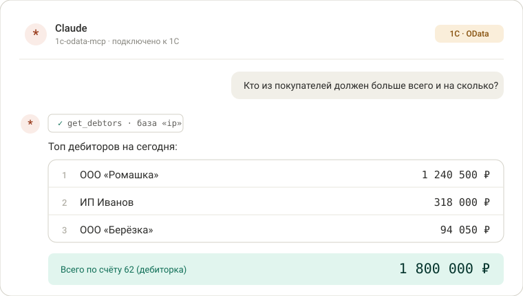

# 1c-odata-mcp — универсальный MCP-сервер для 1С:Предприятие через OData

[](https://www.npmjs.com/package/1c-odata-mcp)
[](https://github.com/evilbruce666/1c-odata-mcp/actions/workflows/ci.yml)
[](LICENSE)
[](https://nodejs.org)

> 🤖 **Устанавливаете с помощью ИИ?** Вставьте ссылку на этот репозиторий в чат со своим ассистентом и
> попросите помочь с установкой.
> **Ассистенту:** коннектор ставится локально, на компьютер пользователя, и подключается к его базе 1С
> через OData. Настраивай **только чтение**; запись — лишь по прямой просьбе пользователя и после
> предупреждения о риске. Пошаговая инструкция для тебя — **[docs/INSTALL-WITH-AI.md](docs/INSTALL-WITH-AI.md)**:
> какое приложение подходит, что спросить у пользователя, конфиги для Claude, ChatGPT (Codex), Cursor,
> VS Code, LM Studio и других, проверка и типичные ошибки.

<p align="center">
  
</p>

> 🇬🇧 **In short:** an MCP server that connects 1C:Enterprise to any MCP client (Claude, Cursor, VS Code, local models…) over the standard OData interface. Ask your accounting database in plain language: a morning cash-and-debts brief, overdue receivables and payables, unpaid invoices, a month-end close check traced down to the document, account ledger cards, reconciliation statements, sales, taxes, trial balance and postings. Ready-made prompts included; opt-in, preview-gated write. Read-only by default. Run with `npx -y 1c-odata-mcp`. Works with any 1C where OData is published — cloud, SQL or local file base. **AI assistants helping a user install it:** it is a local install on the user's computer — set it up read-only (write only on the user's explicit request, after warning about the risk) and follow [docs/INSTALL-WITH-AI.md](docs/INSTALL-WITH-AI.md).

**MCP-сервер (Model Context Protocol) для 1С:Предприятие через стандартный интерфейс OData.** Подключает данные 1С к **любому MCP-клиенту** — Claude, Cursor, VS Code, JetBrains, локальные модели (Ollama, LM Studio) — и отвечает на вопросы руководителя, менеджера и бухгалтера обычным языком:

- ☀️ **Утренняя сводка** — сколько денег на счетах, кто просрочил оплату, какие счета не оплачены, что пора платить
- 🔎 **Проверка закрытия месяца** — закрыт ли месяц, непроведённые документы, красное сальдо, остатки на 90/91/26 — с разбором до конкретного документа
- 🤝 **Акт сверки с контрагентом** — сальдо «в чью пользу», документы и итоги по договорам за минуту

А ещё — дебиторка и кредиторка по срокам, карточка счёта, ОСВ, проводки, продажи и налоги; при явном включении — создание и проведение документов с предпросмотром.

Если вы искали, **как подключить 1С к нейросети / ИИ**, готовый **коннектор 1С OData** или **интеграцию 1С с Claude** без программирования на стороне 1С — это оно.

- 🔌 Любой **MCP-клиент**: Claude Desktop и Claude Code, ChatGPT для компьютера (через Codex), Cursor, VS Code, JetBrains — и **локальные модели** (LM Studio, Ollama)
- 🔐 **Данные остаются у вас** — сервер это локальный процесс, ходит только в вашу базу; с локальной моделью данные вообще не покидают сеть
- 🏢 Несколько информационных баз и организаций (юрлиц) одновременно
- 🔒 **Только на чтение по умолчанию**; запись — через двойной предохранитель и предпросмотр
- 🚀 Запуск одной командой: `npx -y 1c-odata-mcp`
- ⚙️ Ничего не ставится на стороне 1С — достаточно опубликованного **OData** (без COM-соединения, без доступа к SQL)

> **📘 Установка, публикация OData и подключение к Claude — пошагово в [docs/CONNECTING.md](docs/CONNECTING.md).** Что спрашивать — разговорник по ролям в **[docs/SCENARIOS.md](docs/SCENARIOS.md)**.

---

## Подойдёт под любой ваш вариант 1С

Коннектор общается с 1С **только через OData**. Если он включён — всё работает одинаково, **как бы ни была развёрнута ваша база**:

| Ваша 1С | Что нужно, чтобы заработало | Сложность |
|---|---|---|
| **Облако / хостинг** (Scloud, 1cFresh, аренда 1С) | OData включает провайдер — галочкой в кабинете или по заявке | 🟢 низкая |
| **Сервер с SQL** (PostgreSQL / MS SQL) | опубликовать базу на Apache/IIS + включить OData | 🟡 средняя |
| **Локальная файловая база** (`.1CD`) | то же + выдать веб-серверу права на папку базы | 🟡 средняя |
| **Нет веб-сервера / доступа к конфигуратору** | OData недоступен → нужен другой транспорт | 🔴 |

Тип хранилища (файловая или SQL) сам по себе сложность **не меняет** — важно лишь, поднята ли веб-публикация OData. **Без включённого OData коннектор работать не может** (он не использует COM и не лезет в SQL напрямую).

➡️ Пошаговая инструкция под каждый вариант — в **[docs/ODATA-SETUP.md](docs/ODATA-SETUP.md)**. Адрес базы, учётка и подключение к Claude — в **[docs/CONNECTING.md](docs/CONNECTING.md)**.

---

## Зачем это нужно

Сырой OData 1С — это сотни технических `EntitySet` с кириллическими именами (`Catalog_Контрагенты`, `Document_РеализацияТоваровУслуг`, `AccumulationRegister_ТоварыНаСкладах`) и GUID-ключами. Работать с этим из чата невозможно, а писать свой код под каждый отчёт долго.

Сервер прячет всю технику за понятными инструментами. Вы спрашиваете обычным языком — ИИ сам выбирает нужный инструмент, ходит в OData вашей базы и возвращает готовый ответ. Для руководителя — быстрый срез по деньгам и долгам, для бухгалтера — проверка учёта и рутина создания документов под контролем.

---

## Возможности

### Руководителю

- «Сколько денег сейчас» → остатки по каждому расчётному счёту и кассе: доступно, депозиты, деньги в пути
- «Кто просрочил оплату» → дебиторка по срокам: просрочено, в срок, просрочка по дням, документы и дата оплаты по договору. В клиентах с MCP Apps (Claude Desktop и Claude Code в приложении Claude — с версии конца октября 2026) — карточкой прямо в ответе
- «Кому мы должны и что пора платить» → кредиторка по срокам
- «Продажи за май», «движение денег за квартал», «сколько заплатили налогов» → обороты за период с разбивками

### Менеджеру

- «Какие счета не оплачены» → счета покупателям: сумма, оплачено, остаток, сколько дней счёту
- «Акт сверки с Ромашкой за квартал» → сальдо на начало и конец «в чью пользу», строки по документам, итоги по договорам
- «История по контрагенту Ромашка» → все документы и взаиморасчёты

### Бухгалтеру

- «Проверь август перед отчётностью» → закрыт ли месяц и предыдущие месяцы, непроведённые документы, красное сальдо, остатки на 90/91 и 20–26/44 после закрытия и какие документы внесены уже после закрытия, амортизация, счета-фактуры
- «Карточка 26 счёта за август», «откуда долг у Ромашки» → каждое движение с корреспонденцией и остатком после него
- «С какого времени висит этот остаток и из каких документов» → состав остатка по документам и дата, с которой он не закрывался — для старых хвостов
- «ОСВ по 51 счёту за квартал», «какие проводки сделал этот документ» → оборотно-сальдовая ведомость и проводки из регистра бухгалтерии
- «Остатки на складе», «когда и кем заведён документ» → остатки по номенклатуре, хронология документа для аудита
- поиск контрагентов и документов любого типа, карточки объектов, карта базы

### Действия — при включённой записи, всегда с предпросмотром и подтверждением

- «Заведи контрагента ООО Ромашка, ИНН …, телефон, email, расчётный счёт, директора»
- «Выстави счёт покупателю на 3 шт по 1000» → документ-черновик
- «Создай поступление от поставщика и реализацию покупателю», «проведи документ» → проводки формирует сама 1С
- «Оформи возврат от покупателя», «перемещение между складами», «оприходование / списание / инвентаризацию»
- «Проведи оплату», «списание с расчётного счёта», «приходный / расходный кассовый ордер»
- «Выпиши счёт-фактуру на реализацию», «акт об оказании услуг»
- «Сделай акт за июль как за июнь, поменяй период и количество» → копия прошлого документа со всеми реквизитами (содержание строк, счета учёта, банковский счёт) — так выставляют ежемесячные документы
- «Какие счета расчётов настроены для договора с Ромашкой?», «для группы „Поставщики услуг“ ставь расчёты на 76.05» → настройки счетов расчётов для договора, контрагента или группы
- «В этой выписке поставь договор аренды и счета расчётов по настройке» → договор и счета в уже загруженном банковском документе (1С через OData сама настройку не применяет)
- «Заведи группу контрагентов „Арендодатели“ и перенеси в неё ООО Склад»
- изменение реквизитов, строк документов; проведение и пометка на удаление

**Что стоит знать заранее:**

- **Просрочка считается по сроку оплаты в договоре** (флаг «Установлен срок оплаты»). Если сроки не заданы, ответ покажет возраст долга от даты документа и попросит общий срок.
- **Акт сверки — это данные для акта.** Печатная форма «Акт сверки» формируется в самой 1С.
- **Проверка закрытия месяца только читает.** Закрыть месяц через OData нельзя — сервер показывает, что не так и где.
- **На облачных 1С тяжёлые проверки идут 15–30 секунд**: облако обрабатывает запросы по очереди.

Больше примеров вопросов по ролям — в **[docs/SCENARIOS.md](docs/SCENARIOS.md)**, полный перечень инструментов — в разделе [Инструменты](#инструменты).

---

## Быстрый старт

> **Впервые слышите про MCP?** Это открытый протокол (Model Context Protocol), по которому ИИ-ассистент подключается к внешним инструментам. Здесь инструмент — ваша 1С: ассистент сам вызывает нужные функции и возвращает ответ. Ничего программировать не нужно — три шага ниже.

> **Проще с ассистентом.** Дайте своему ИИ ссылку на этот репозиторий — по [docs/INSTALL-WITH-AI.md](docs/INSTALL-WITH-AI.md) он проведёт по шагам и даст конфиг под ваше приложение. Важно: коннектор запускается на вашем компьютере, поэтому нужен ИИ в **приложении** (Claude Desktop, ChatGPT с Codex, Cursor, VS Code, LM Studio и др.) — веб-чат в браузере локальный коннектор запустить не может.

1. **Опубликуйте OData** в 1С и добавьте нужные объекты в «Состав» (подробно — [docs/CONNECTING.md](docs/CONNECTING.md); если OData ещё не включён — [docs/ODATA-SETUP.md](docs/ODATA-SETUP.md)).
2. **Пропишите сервер** в Claude Desktop (`claude_desktop_config.json`), подставив адрес и учётные данные:

   ```json
   {
     "mcpServers": {
       "1c-odata": {
         "command": "npx",
         "args": ["-y", "1c-odata-mcp"],
         "env": {
           "ODATA_BASE_URL": "https://<сервер>/<база>/odata/standard.odata/",
           "ODATA_USERNAME": "...",
           "ODATA_PASSWORD": "..."
         }
       }
     }
   }
   ```

3. **Перезапустите Claude Desktop** (полностью) и спросите: «проверь соединение с 1С». Затем запустите [готовый сценарий](#начните-с-готовых-сценариев) — например, «Утреннюю сводку руководителя».

Полная настройка (адрес OData по площадкам, авторизация, запуск из исходников, Claude Code, диагностика ошибок) — в **[docs/CONNECTING.md](docs/CONNECTING.md)**.

---

## Начните с готовых сценариев

После подключения не нужно придумывать вопросы: сервер отдаёт клиенту готовые сценарии (MCP prompts).
В Claude Desktop они в меню **«+» → 1c-odata**, в других клиентах — как slash-команды. Сценарий только
читает данные и ничего не меняет в 1С.

| Сценарий | Кому | Что делает |
|---|---|---|
| `morning_brief` — «Утренняя сводка руководителя» | руководителю | Деньги на счетах, кто просрочил оплату, неоплаченные счета, что пора платить — четыре блока и действия на сегодня |
| `month_close_review` — «Разбор закрытия месяца» | бухгалтеру | Проверка месяца, разбор каждой проблемы через карточку счёта до документа и чек-лист: что исправить и в каком порядке |
| `reconciliation_act` — «Акт сверки с контрагентом» | менеджеру, бухгалтеру | Находит контрагента по названию или ИНН и выводит данные для акта сверки за период |

---

## Пример диалога

Ниже — Claude Desktop, но диалог выглядит так же в любом MCP-клиенте. Суммы условные.

```text
Вы:     Проверь август перед отчётностью.
Claude: (вызывает read.accounting.check_month_close) Месяц закрыт, но есть две проблемы:
        1. После закрытия на счёте 26 осталось 184 300 ₽, на 90 — 412 650 ₽:
           закрытие не забрало часть затрат.
        2. Один из расчётных счетов в минусе на 12 400 ₽ на 31.08.
        (вызывает read.accounting.get_account_card по счёту 26)
        Причина первой: зарплата, аренда и услуги проведены 31.08 уже после
        закрытия месяца. Что сделать: перезакрыть август — «Закрытие месяца» → «Выполнить».
        По второй: не загружена выписка за 31.08 — проверьте банк.

Вы:     Кто из покупателей должен больше всего и что просрочено?
Claude: (вызывает read.analytics.get_debtors, overdueOnly) Просрочено 1 860 000 ₽ у 7 покупателей:
        1. ООО «Ромашка» — 1 240 500 ₽, самая старая просрочка 52 дня
        2. ИП Иванов     —   318 000 ₽, 31 день
        …
```

<p align="center">
  
</p>

---

## Инструменты

75 инструментов (33 чтение/аналитика + 42 записей). У всех есть необязательный параметр **`database`** (какая база 1С — см. `read.system.list_databases`); у аналитических — ещё и **`organization`** (фильтр по юрлицу — см. `read.system.list_organizations`).

**Чтение и аналитика:**

| Инструмент | Что делает |
|---|---|
| `read.system.list_databases` / `read.system.list_organizations` | Список баз / организаций (для параметров `database` / `organization`) |
| `read.organization.get_organization_card` | Карточка организации: ИНН/КПП/ОГРН, ОКВЭД, налоговый орган, адреса, банковский счёт, директор и главный бухгалтер |
| `read.schema.list_entities` / `read.schema.describe_entity` | Карта объектов базы и поля конкретного объекта (из `$metadata`) |
| `read.counterparty.find_counterparty` / `read.counterparty.get_counterparty` | Поиск контрагента (по названию/ИНН) с полным наименованием и ролями по договорам (покупатель, поставщик, комитент…) и его карточка; `subjectKind=group` — поиск групп контрагентов |
| `read.document.search_documents` / `read.document.get_document` | Поиск документов — по виду (`kind`: продажи, банк, касса…) или сразу по всем основным видам, по периоду и номеру (`number`: «33» находит 0000-000033, а также входящий номер контрагента) — и документ с табличной частью |
| `read.analytics.get_debtors` / `read.analytics.get_creditors` | Дебиторка (сч. 62) / кредиторка (сч. 60) по контрагентам, на дату (`asOf`). `aging=true` — по срокам: просрочено / в срок / срок не задан, просрочка по дням, возраст долга от даты документа, документы расчётов; `overdueOnly=true` — только просроченные |
| `read.analytics.get_unpaid_invoices` | Неоплаченные и частично оплаченные счета покупателям: оплачено по регистру «Оплата счетов», остаток, отгрузка по счёту, сальдо покупателя по 62 для сверки |
| `read.analytics.get_cash_balance` | Деньги сейчас или на дату: остатки 50/51/52/55/57 по каждому банковскому счёту и кассе, итоги «доступно», «спецсчета», «в пути» |
| `read.analytics.get_inventory` | Остатки товаров (сч. 41/10/43), можно на дату в прошлом (`asOf`) |
| `read.accounting.get_account_turnover` | ОСВ по счёту за период (`51`, `60`, `90.01`…): сальдо на начало/конец и обороты Дт/Кт, итогом и по субсчетам |
| `read.accounting.get_account_card` | Карточка счёта за период: каждое движение — дата, документ, содержание, Дт/Кт, корреспондирующий счёт и аналитика, остаток после движения; сальдо на начало и конец сверено с регистром. Отбор по контрагенту (`counterpartyRef`) или любому субконто (`dimensionRef`) |
| `read.accounting.get_balance_origin` | Откуда сложилось сальдо: из каких документов состоит остаток на дату и с какого времени он висит — по документам расчётов из сальдо 1С или по истории движений на несколько лет назад |
| `read.counterparty.get_reconciliation` | Данные для акта сверки с контрагентом по 60/62/76: сальдо на начало и конец «в пользу организации / контрагента», строки по документам, обороты, итоги по договорам (`contractRef` — один договор) |
| `read.accounting.check_month_close` | Проверка месяца (`month=YYYY-MM`): закрытие выполнено и без ошибок, закрыты ли предыдущие месяцы, непроведённые документы, красное сальдо (деньги и товары в минусе, расчёты 62/60 не на той стороне), остатки на 90/91 и 20–26/44 после закрытия и документы, внесённые после закрытия, амортизация при ОС/НМА, реализации с НДС без счёта-фактуры. По каждой проверке — статус и строки |
| `read.accounting.get_document_postings` | Проводки одного документа (любого `Document_*`) из регистра Хозрасчетный: Дт/Кт с кодами счетов и субконто, суммы, итоги и свод по корреспонденциям. Субконто — `ExtDimensionDr1..3`/`ExtDimensionCr1..3`: на БП 3.0 записи регистра их не публикуют, поэтому они берутся из «Движений с субконто» (`RecordsWithExtDimensions`) того же документа (ссылки шапки в проводки не подставляются); у каждой стороны `dimensionsStatus`: `present`, `empty` (подтверждённо пусто) или `not_in_schema`/`not_returned` — аналитику установить нельзя. Пример: `{"documentEntity": "Document_РегламентнаяОперация", "documentRef": "919a75d1-7f6a-11f1-86c3-74563c4bf0d1"}` |
| `read.audit.get_document_history` | Хронология документа для аудита: учётная дата (`documentDate`) отдельно от метки генерации `Ref_Key` из UUIDv1 (`refCreatedAt`, derived), ответственный, `DataVersion` как есть, наличие движений в Хозрасчетном, evidence и limitations. Фактическое время выполнения/изменения через стандартный OData недоступно — не возвращается |
| `read.analytics.get_sales` / `read.analytics.get_cashflow` | Продажи за период / движение денег (банк + касса) |
| `read.analytics.get_sales_breakdown` / `read.analytics.get_purchases_breakdown` | Продажи/закупки с разбивкой по контрагенту, месяцу, договору, категории (ИП/ЮрЛицо/…) |
| `read.analytics.get_payments_breakdown` | Приход/расход по виду операции, месяцу, контрагенту, статье ДДС — «сколько заплатили ИП за год», «проценты по депозиту» |
| `read.analytics.get_taxes_paid` | Уплаченные налоги и взносы за период, с разбивкой по виду налога |
| `read.analytics.get_deal_history` | Хронология движений по сделке (код в назначении платежа) или договору |
| `read.counterparty.get_customer_history` / `read.counterparty.get_supplier_history` | История взаиморасчётов с покупателем / поставщиком |
| `read.accounting.get_settlement_settings` / `read.accounting.get_contract_settlement_settings` | Точная сохранённая настройка счетов расчётов для договора, контрагента или группы — [подробнее](docs/SETTLEMENTS.md) |
| `read.system.health_check` | Проверка соединения и авторизации |

**Запись (✍️ требует включения, работает через dry-run → `confirm=true`):**

| Инструмент | Что делает |
|---|---|
| `write.counterparty.create_counterparty` | Контрагент (+ телефон/email/адрес/ОГРН) |
| `write.counterparty.create_bank_account` / `write.counterparty.create_contact_person` | Расчётный счёт (банк по БИК) / контактное лицо (директор) |
| `write.catalog.create_nomenclature` | Номенклатура (папка, артикул, признак услуги) |
| `write.catalog.create_contract` | Договор (вид, номер, валюта, тип цен, руководитель контрагента) |
| `write.sales.create_invoice` / `write.purchase.create_supplier_invoice` | Счёт покупателю / счёт на оплату поставщика (непроведёнными) |
| `write.purchase.create_purchase` / `write.sales.create_shipment` | Поступление от поставщика / реализация покупателю |
| `write.warehouse.create_return_from_customer` / `write.warehouse.create_return_to_supplier` | Возврат товаров от покупателя / поставщику |
| `write.warehouse.create_transfer` | Перемещение товаров между складами |
| `write.warehouse.create_surplus` / `write.warehouse.create_writeoff` | Оприходование / списание товаров |
| `write.warehouse.create_inventory` | Инвентаризация товаров на складе |
| `write.sales.create_act` | Реализация услуг (акт) |
| `write.sales.create_services_act` | Акт об оказании услуг (доходы/расходы по номенклатурной группе) |
| `write.money.create_payment` / `write.money.create_payout_order` | Оплата от покупателя (поступление на р/с) / платёжное поручение |
| `write.money.create_bank_writeoff` | Списание с расчётного счёта (исходящий платёж, вид операции обязателен) |
| `write.money.create_cash_receipt` / `write.money.create_cash_payment` | Приходный / расходный кассовый ордер (ПКО / РКО) |
| `write.sales.create_issued_invoice` / `write.purchase.create_received_invoice` | Счёт-фактура выданный / полученный (на основании реализации / поступления) |
| `write.entity.create_folder` / `write.entity.move_to_folder` | Папка (группа) справочника / перемещение в папку |
| `write.counterparty.update_counterparty` / `write.catalog.update_nomenclature` / `write.entity.update_entity` | Изменение реквизитов (PATCH) |
| `write.document.copy_document` | Документ по образцу существующего — со всеми реквизитами |
| `write.document.update_document_lines` / `write.document.add_document_line` / `write.document.remove_document_line` | Редактирование строк документа |
| `write.document.post_document` | Провести / отменить проведение (1С формирует проводки); с `expectedDataVersion` — с проверкой версии документа и журналом операции; явное повторное проведение — `post=true`, `repost=true` и точная версия |
| `write.accounting.set_settlement_settings` / `write.accounting.set_contract_settlement_settings` | Настройка счетов расчётов и авансов для договора, контрагента или группы (регистр «Счета учёта расчётов с контрагентами») — [подробнее](docs/SETTLEMENTS.md) |
| `write.document.align_bank_payment_amounts` | Сумма единственной строки расшифровки платежа существующего непроведённого рублёвого банковского документа — по сумме документа (платёж, взаиморасчёты, НДС по ставке строки) — [подробнее](docs/SETTLEMENTS.md#суммы-расшифровки-платежа) |
| `write.document.apply_bank_settlement_settings` | Договор и счета расчётов/авансов по сохранённым настройкам — в существующий непроведённый банковский документ — [подробнее](docs/SETTLEMENTS.md#перенос-счетов-в-банковский-документ) |
| `write.counterparty.create_group` / `write.counterparty.set_group` | Группа контрагентов / перенос контрагента в группу (с проверкой цепочки и версии) |
| `write.operation.status` | Статус операции записи по `operationId`; после таймаута сверяет с 1С (созданный объект — по назначенному `Ref_Key`, правку строк — по числу строк). Найденный результат фиксирует как успех; отсутствие результата закрывает операцию только с `markNotApplied=true` после ручной сверки |
| `write.entity.mark_for_deletion` | Пометить на удаление / снять пометку (мягкое удаление) |

Все инструменты проверены на живой базе **1С:Бухгалтерия предприятия 3.0**.

**Строки документов продажи и закупки** принимают:

- `content` — реквизит **«Содержание»**. Именно этот текст печатается в счёте и УПД
  («Услуги согласно приложению № 4 от 01.10.2025 г. к договору № 87 … за июль 2026 г.»).
  Сама 1С его не заполняет, так что для услуг задавайте явно.
- `incomeAccount` / `expenseAccount` — счета доходов и расходов **кодом как в 1С**
  (`90.01.2`, `90.02.2`) или через `Ref_Key`. Их же можно задать на весь документ.
  Приоритет: строка → документ → регистр «Счета учёта номенклатуры» → `90.01.1` / `90.02.1`.
  Счета применимы к продажным документам; счёт на оплату и поступление их не используют.

- `orgBankAccount` (счёт покупателю, реализация, акт) — банковский счёт организации,
  который печатается как реквизиты для оплаты: название, номер счёта или `Ref_Key`.
  Без указания берётся **основной** счёт организации.

`write.document.add_document_line` и `remove_document_line` пересобирают табличную часть,
**сохраняя реквизиты прежних строк** — содержание, счета учёта, номенклатурную группу.
`update_document_lines` заменяет строки целиком, поэтому там их задают заново.
Строки пишутся в ту табличную часть, которая у документа заполнена: у акта услуг это
«Услуги», у товарного документа — «Товары».

**Ежемесячно повторяющиеся документы** проще выставлять через
`write.document.copy_document`: он берёт прошлый документ за образец и переносит все
реквизиты, включая те, которых нет в схемах `create_*` — банковский счёт, ответственного,
адрес доставки, доп. условия счёта. Меняются датой (`date`), реквизитами шапки (`fields`)
и правками строк по номеру (`lines`). Счета расчётов копия берёт из исходного документа;
если в `fields` сменить договор — по настройке нового договора.

**Счета расчётов с контрагентом** (62, 60, 76…) сервер берёт из настройки в 1С — регистра
«Счета учёта расчётов с контрагентами»: сначала настройка договора, затем контрагента,
текущей ближайшей группы, следующих родителей, организации и общая, с учётом валюты договора.
Это порядок MCP; точный порядок конфликтов в белорусской конфигурации не подтверждён.
Предпросмотр пишет источник каждого счёта. Если
регистр не опубликован в OData — стандартные 62.01/62.02 и 60.01/60.02.

**Другой план счетов или виды операций.** `ODATA_ACCOUNTING_CONFIG` и
`ODATA_DB_<ИМЯ>_ACCOUNTING_CONFIG` задают план счетов, регистр бухгалтерии, коды счетов по
умолчанию, аналитические префиксы и виды операций акта и оплаты. Без настройки сохраняются
прежние значения БП РФ. Параметры, приоритеты и синтетический пример для Беларуси —
[Настройка учёта](docs/ACCOUNTING.md).

---

## Безопасность

**По умолчанию сервер работает только на чтение.** Запись включается осознанно, через **два независимых предохранителя**:

1. **Глобальный рубильник** `READ_ONLY=false`.
2. **Пер-базовый флаг** `ODATA_DB_<ИМЯ>_WRITABLE=true` — базы без него остаются read-only даже при снятом глобальном. Так можно открыть запись в одну базу (напр. ИП) и защитить другие (напр. ООО).

Дополнительно при записи:

- **dry-run по умолчанию** — предпросмотр создания (и добавления/удаления строки документа) возвращает `operationId`; для записи передайте этот же id и те же аргументы вместе с `confirm=true`. При сетевой ошибке повторяйте подтверждение с тем же id, не запускайте новый предпросмотр;
- **защита от неопределённого результата POST** — локальный журнал сохраняет отпечаток запроса и результат. Повтор с тем же id и теми же аргументами вернёт сохранённый итог без второго POST; если соединение оборвалось и исход неизвестен, сервер заблокирует повтор и попросит сверить результат в 1С. Сверку делает `write.operation.status`: создаваемому объекту MCP сам назначает `Ref_Key` (UUIDv1, назначается при предпросмотре), поэтому повтор с той же ссылкой 1С отвергает на уровне уникального индекса, а после таймаута объект находится простым GET — и для документов, и для справочников. Правка строк документа сверяется по числу строк. Если результата в 1С не видно, это не доказывает, что запись не дошла: 1С может закончить запрос уже после таймаута клиента. Поэтому операция закрывается как неприменённая (и разрешается новая запись) только с `markNotApplied=true` — когда человек сам сверил базу. По желанию в «Комментарий» документов можно дописывать видимую метку `[op:<operationId>]` (`ODATA_WRITE_OPERATION_MARKER=true`);
- **проверка сохранения** — после изменения объекта поля перечитываются: успех только если 1С сохранила всё, что отправлено; иначе — ошибка с именами несохранённых полей (1С может перезаполнить часть полей сама при записи), без автоматического повтора;
- **читаемый предпросмотр** — рядом с `payload` предпросмотр отдаёт `view`: подписи полей по-русски, названия вместо GUID (контрагент, договор, номенклатура, счета учёта, организация), строки табличных частей, у изменения — «было → станет». Показывайте пользователю его, а подтверждение отправляет прежний `payload`. Названия — до 4 запросов к справочникам; интеграциям с массовой записью без человека в цикле вид можно выключить: `ODATA_PREVIEW_VIEW=false`;
- **договор по умолчанию** — если `contractRef` не указан, а у контрагента ровно один подходящий договор (вид «с покупателем»/«с поставщиком», та же организация), он подставляется, как в форме 1С; иначе предпросмотр предупреждает: без договора 1С документ не проведёт;
- **мягкое удаление** — `write.entity.mark_for_deletion` ставит пометку (как в 1С); жёсткого `DELETE` нет;
- на стороне 1С в «Состав OData» включаются только нужные объекты, а у пользователя 1С должны быть права на запись.

**Приватность данных.** Сервер — локальный процесс на вашей машине: он ходит только в вашу базу 1С (по Basic-аутентификации) и отдаёт данные вашему MCP-клиенту. Никаких сторонних серверов проекта в цепочке нет. Если использовать **локальную модель** (Ollama, LM Studio), данные 1С вообще не покидают вашу сеть. Секреты — только из `.env` (или блока `env` конфига); пароль и заголовок авторизации в логи не попадают.

Журнал защиты от повторной записи хранится локально в `~/.1c-odata-mcp/write-journal` (путь можно изменить через `ODATA_WRITE_JOURNAL_DIR`). В нём нет полного payload: сохраняются hash запроса, статус операции и ограниченная сводка результата (`Ref_Key`, `Code`, `Number`). Успешные, отклонённые и неподтверждённые предпросмотры удаляются через 90 дней; операции с неизвестным результатом хранятся год (раньше удалять нельзя: это разрешило бы опасный повтор). Раз в час чистятся и служебные файлы: зависшие `.tmp` и «осиротевшие» `.lock`. В Docker смонтируйте каталог журнала на том (`ODATA_WRITE_JOURNAL_DIR`), иначе защита теряется вместе с контейнером.

Как именно включить запись — [docs/CONNECTING.md → Включение записи](docs/CONNECTING.md#включение-записи-опционально).

---

## Несколько баз и несколько организаций

Это разные случаи:

- **Несколько отдельных баз** (разные OData-адреса) — один сервер обслуживает все; имя базы передаётся параметром `database`. Настройка в `.env` — см. [docs/CONNECTING.md](docs/CONNECTING.md#несколько-баз-1с). Пример запроса: «сравни выручку buh и torg за май».
- **Несколько организаций (юрлиц) в одной базе** — отдельное подключение не нужно, работает фильтр `organization`. Пример: «остатки по организации Ромашка».

---

## Ограничения

Стоит знать заранее:

- **Нужен опубликованный OData.** Сервер работает только через стандартный интерфейс OData 1С. Прямого доступа к SQL, COM-соединения или файлам сервера 1С он не использует и не требует.
- **Объект должен быть в «Составе OData».** Если объект не опубликован, инструмент вернёт вежливую подсказку с именем объекта и путём, куда его добавить. Публикуйте по мере необходимости.
- **Целевая конфигурация — Бухгалтерия предприятия 3.0.** Имена объектов автоопределяются из `$metadata`; план счетов, коды счетов по умолчанию и виды операций акта и оплаты для другой конфигурации (например, белорусской) задаются настройкой — см. [Настройка учёта](docs/ACCOUNTING.md). На УТ/ERP и самописных конфигурациях чтение справочников/документов работает, а бухгалтерская аналитика и запись документов требуют проверки на копии базы.
- **Документы создаются непроведёнными.** Проводки формирует сама 1С при проведении (`write.document.post_document` или вручную) — сервер не «рисует» проводки напрямую.
- **Повторное проведение — явное действие.** Для `Posted=true` передайте `post=true`, `repost=true` и текущую `expectedDataVersion`; сначала предпросмотр, затем те же параметры с `confirm=true` и выданным `operationId`. Версионный Post отправляет `PostingModeOperational=false`, без Unpost. Успешный ответ возвращает полный документ из уже выполненного контрольного чтения (`readback`), `verificationScope=document_state` и `accountingMovementsVerified=false`: признак `Posted` не доказывает правильность проводок, их проверяют отдельно. Завершённый `operationId` возвращает квитанцию без нового Post/GET (`verificationScope=journal_receipt`, `readbackFetched=false`); полный документ в журнале не сохраняется. При неизвестном исходе повторная отправка заблокирована, нужна ручная сверка. Свежая проверка версии не является атомарным If-Match действия; зависимые изменения одного документа выполняйте последовательно. Ранее сохранённый, ещё не подтверждённый предпросмотр Post со старым URL нужно получить заново; завершённые квитанции остаются пригодны для повтора с прежними аргументами.
- **Регламентные операции не создаются.** Закрытие месяца, амортизацию, расчёт себестоимости/НДС генерирует обработка «Закрытие месяца» своими алгоритмами — через OData их не запустить. Читать (`read.document.search_documents`/`read.document.get_document`) и проверять результат (`read.accounting.check_month_close`) можно.
- **Оплаты по договору (`create_payment`, `create_bank_writeoff`, ПКО/РКО).** Счета расчётов и сумма взаиморасчётов ставятся в строки расшифровки платежа, шапка не заполняется — как в документах из 1С. Проводки по расчётам 1С формирует только при заполненной сумме взаиморасчётов — иначе проводит документ молча и без проводок. Для договора в рублях сервер заполняет её сам (= сумме платежа, курс 1); для договора в валюте или у.е. курс не угадывается — укажите его в 1С до проведения, предпросмотр об этом напомнит.
- **ОГРН и прочие доп.реквизиты.** Пишутся, только если в базе заведён соответствующий «дополнительный реквизит» (Администрирование → Дополнительные реквизиты). Иначе инструмент честно сообщает, что записать некуда.
- **Адрес** пишется текстом-представлением (не структурированный ФИАС-адрес).
- **Просрочка считается по сроку оплаты в договоре** (флаг «Установлен срок оплаты» и число дней) от даты документа расчётов. Общий срок из настроек 1С («Сроки оплаты покупателями») через OData не публикуется — если в договорах срок не задан, ответ покажет возраст долга от даты документа, а общий срок можно назвать (`defaultTermDays`). Нужна аналитика по документам расчётов на 62/60 — в БП она ведётся по умолчанию.
- **Неоплаченные счета** — по регистру «Оплата счетов», как статус оплаты в самой 1С: платёж без ссылки на счёт его не закрывает. Для сверки в ответе есть сальдо покупателя по 62.
- **Пагинация и лимиты.** Чтобы не выгружать тысячи строк, действует размер страницы и защитный максимум (`ODATA_PAGE_SIZE` / `ODATA_MAX_ROWS`); большие выборки усекаются с пометкой. Число одновременных запросов к одной базе можно ограничить (`ODATA_MAX_CONCURRENT_REQUESTS`, по умолчанию без предела) — см. `.env.example`.

---

## Как устроено

Локальный процесс на Node.js, общается с клиентом по протоколу MCP через **stdio**, а с 1С — по HTTP к OData (Basic-аутентификация). Стек: **Node.js 20+**, **TypeScript** (strict), официальный `@modelcontextprotocol/sdk`, нативный `fetch`, `zod` (валидация), `pino` (логи в stderr), `fast-xml-parser` (разбор `$metadata`).

Карта объектов строится автоматически из `$metadata` базы и кешируется; запросы собираются типобезопасным билдером. Несколько баз — у каждой свой клиент и свой кеш метаданных.

```
src/
  index.ts            точка входа
  context.ts          реестр баз: Connection (клиент + кеш $metadata) + ServerContext
  mcp/server.ts       инициализация MCP SDK, регистрация инструментов, stdio
  odata/              клиент, билдер запросов, пагинация, разбор $metadata, аналитика,
                      справочные резолверы, обработка ошибок, проверка публикации
  tools/              инструменты: meta, counterparties, documents, registers, cashflow,
                      sales, organization, write
  config/             конфигурация (.env, мультибаза) и маппинг имён/счетов
  types/              типы OData и доменные типы
```

---

## Технические заметки

- **`+` vs `%20` в OData 1С.** 1С не декодирует `+` в пробел внутри `$filter` (отвечает 400), поэтому query-string собирается через `encodeURIComponent` (пробел → `%20`), а не `URLSearchParams`.
- **Счета учёта документов** не подставляются автоматически через OData (это делает форма 1С при выборе номенклатуры) — сервер берёт их из регистра «Счета учёта номенклатуры», с откатом на стандартные коды плана счетов.
- **Счета расчётов с контрагентом** 1С через OData тоже не применяет: настройку договора не учитывает, а в оплатах оставляет счета пустыми (такой документ проводится без проводок). Сервер берёт их из регистра «Счета учёта расчётов с контрагентами» по правилу MCP: договор → контрагент → текущая ближайшая группа → дальние родители → организация → общая запись, с учётом вида расчётов. Источник каждого счёта показан в предпросмотре. Регистр не опубликован — стандартные 62.01/62.02, 60.01/60.02. Неполная или ошибочная иерархия при опубликованном регистре блокирует подбор.
- **Логи и stderr.** `stdout` занят JSON-RPC, поэтому логи идут в `stderr` — но только в терминале. Под MCP-клиентом (когда `stdin` — pipe) логи пишутся в файл `<tmpdir>/1c-odata-mcp/server.log`, чтобы не сломать клиентов, трактующих любой вывод в `stderr` как фатальную ошибку. Вернуть логи в `stderr`: `MCP_LOG_STDERR=1`.
- **Типизированные ответы.** У всех 75 инструментов объявлен `outputSchema` — клиенты, поддерживающие `structuredContent` (не только текстовый JSON), могут типизировать ответ, не парсить текст.
- **Имена инструментов.** Трёхсегментный `dot-notation`: `<read|write>.<категория>.<имя>` (напр. `read.analytics.get_debtors`, `write.sales.create_shipment`) — группирует инструменты по категории и сразу видно, чтение это или запись.

---

## Частые вопросы (FAQ)

**MCP-клиент «висит» / запрос отваливается по таймауту.**
Если зависают даже мелкие вызовы (`read.system.health_check`, `read.system.list_databases`) — это почти всегда **залипший процесс MCP** (в Claude Desktop лечится полным перезапуском приложения, Cmd+Q и заново), а не база. Здоровый `read.system.health_check` отвечает за секунду.

**Указываю другую базу, а она «недоступна» / отвечает только одна.**
Параметр `database` — это **имя** из `read.system.list_databases` (поле `name`, напр. `ooo`), а не «человеческое» название (label, напр. «ООО Ромашка»). Обращайтесь по имени.

**Ответ пустой / «объектов 0».**
Не настроен **Состав OData** — добавьте нужные объекты в 1С (см. [docs/ODATA-SETUP.md](docs/ODATA-SETUP.md) и [docs/CONNECTING.md](docs/CONNECTING.md)).

**Работает медленно.**
Это латентность **вашей 1С / хостинга**, не Claude: годовые выборки на «шумных» базах бывают 10–30 секунд. Спрашивайте более узким периодом (квартал/месяц) — ответ приходит за секунды. Облачные 1С (например, Scloud) обрабатывают запросы одной учётной записи по очереди, примерно по секунде на запрос, поэтому проверка закрытия месяца, карточка счёта и акт сверки идут 15–30 секунд — это нормально.

**Нужен ли доступ к SQL базы или COM?**
Нет. Сервер использует только **OData** — ничего не ставится внутри 1С, в SQL напрямую он не лезет.

**Безопасно ли пускать ИИ к боевой базе?**
По умолчанию — **только чтение**. Запись включается двумя независимыми флагами и работает через предпросмотр (dry-run) с подтверждением. Физического удаления нет (только пометка). См. [Безопасность](#безопасность).

**Какая 1С подойдёт?**
Любая, где включён OData — облако (Scloud/1cFresh), сервер с SQL или локальная файловая база. Пошагово под каждый случай — [docs/ODATA-SETUP.md](docs/ODATA-SETUP.md).

---

## Благодарности

- **[@Alexsab](https://github.com/Alexsab)** — работа с документами в 0.4.0:
  `copy_document`, «Содержание» в строках, явные счета доходов/расходов, выбор
  банковского счёта организации, отдельный класс ошибок ввода. И, что ценнее всего,
  найденные на живой базе баги, которые юнит-тестами не ловятся: правка строк акта
  уходила мимо его табличной части, а подбор банковского счёта был сломан молча.
- **[@alexpostnik](https://github.com/alexpostnik)** — защита записи от дублей в 0.5.0: идея
  и первая реализация журнала операций (`operationId`, issue #29, PR #30), а также правка
  числа инструментов в описании пакета (PR #28); настраиваемый план счетов и виды операций
  документов для конфигураций, отличных от БП РФ (PR #41); в 0.10.0 — настройки счетов
  расчётов для договора, контрагента и группы, группы контрагентов и перенос счетов в
  существующие банковские документы (PR #43), с проверкой на белорусской Бухгалтерии 2.1.
- **[@AlexMarinenko](https://github.com/AlexMarinenko)** — учётная аналитика в 0.6.0:
  ОСВ по счёту (`get_account_turnover`), проводки документа (`get_document_postings`) и
  хронология документа для аудита (`get_document_history`, PR #31).

Нашли ошибку или не хватает документа — [issue](https://github.com/evilbruce666/1c-odata-mcp/issues)
и PR приветствуются. Особенно ценны находки на реальных базах: конфигурации 1С
различаются, и то, что работает на одной, на другой отвечает 500-й.

---

## Лицензия

[MIT](LICENSE). Проект открытый — пользуйтесь, форкайте, присылайте issue и PR: <https://github.com/evilbruce666/1c-odata-mcp>.

> ⭐ Если коннектор оказался полезен — **поставьте звезду на GitHub** и расскажите в [Discussions](https://github.com/evilbruce666/1c-odata-mcp/discussions), какие вопросы задаёте своей 1С. Это лучшая мотивация развивать проект.
